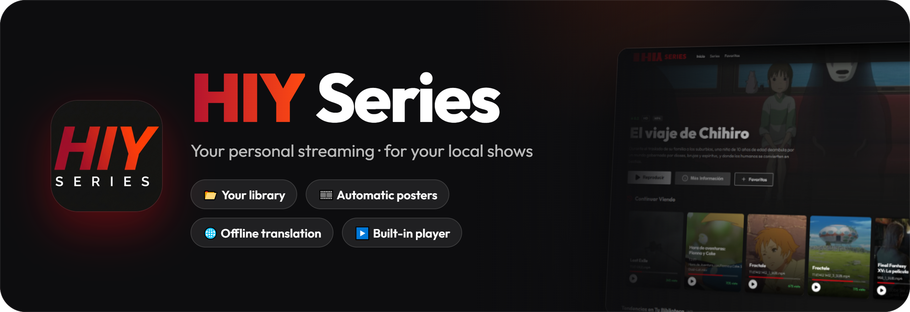
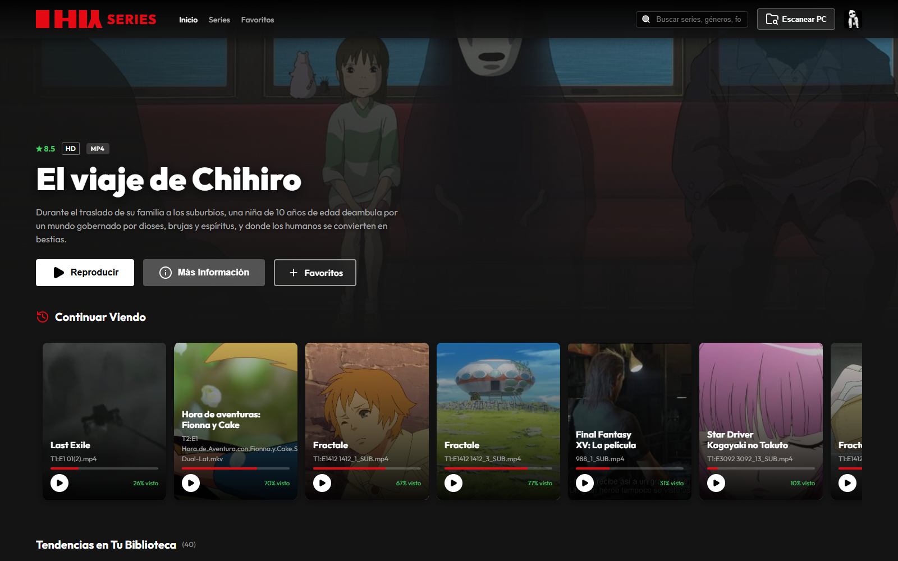
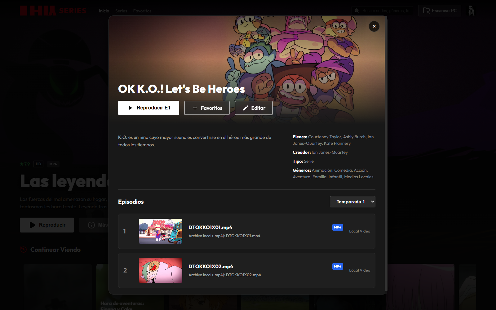
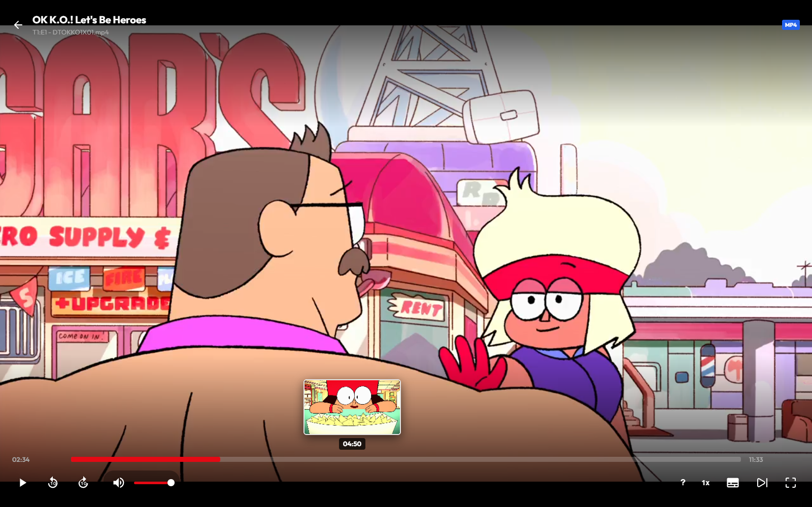

<p align="center"><a href="README.md">🇪🇸 Español</a> · <a href="README.en.md">🇬🇧 English</a></p>

<div align="center">



<br>

[](../../releases/latest)
[](../../releases/latest)
[](https://www.electronjs.org/)
[](#-in-your-language)

### Your shows and movies, like on a streaming platform 🍿

**Pick the folder with your videos · HIY Series builds the catalog with posters, descriptions and seasons.**

<br>

<a href="../../releases/latest">
  
</a>

</div>

<div align="center">

## 🎉 Out now: HIY Series 1.0.0



📂 Scan your folders · 🎞️ Automatic posters and descriptions · 🌐 Offline translation · 👤 Profiles with photos · ⏯️ Continue watching · ❤️ Favorites · 🎬 Player with thumbnails, subtitles and Dolby/DTS audio · 🐞 Report bugs from the app

</div>

<br>

## 📺 Screenshots

<div align="center">


<sub><b>Home</b> · featured banner, <i>Continue watching</i> and rows by genre</sub>

<br><br>

<table>
  <tr>
    <td align="center" width="50%"><br><sub><b>More info</b> · seasons and episodes</sub></td>
    <td align="center" width="50%"><br><sub><b>Player</b> · thumbnails on the seek bar</sub></td>
  </tr>
</table>

<sub>Screenshots show the app in Spanish; it is also available in English.</sub>

</div>

<br>

## Features

- **Local library**: scans folders with `.mp4`, `.mkv` and `.webm` videos and detects seasons and episodes. It also tells you when new videos show up.
- **Automatic metadata**: description, genres, year, rating, poster and banner from the folder name. Sources:
  1. [TMDB](https://www.themoviedb.org/) (movies, shows and anime, in Spanish; requires a free API key)
  2. [AniList](https://anilist.co/) (anime, no key)
  3. [TVMaze](https://www.tvmaze.com/) (shows, no key)
- **Local translation** of descriptions English → Spanish with Marian models (`opus-mt`) via Transformers.js + ONNX. Works offline, with no key and no limits.
- **Profiles** with photo, color, language and playback preferences.
- **Continue watching** and **My list** per profile.
- **Built-in player**:
  - Instant seeking using the keyframes from the MP4/MKV index.
  - `.srt`/`.vtt` subtitles next to the video or loaded by hand (`.srt` files are converted to WebVTT).
  - AC3, E-AC3, DTS and TrueHD audio converted to AAC in real time with ffmpeg.
  - Autoplay of the next episode, speed and volume.
- **Interface in Spanish and English**, with a welcome screen and tutorial.

<br>

## 🌍 In your language

The app and the installer are in **English** 🇬🇧 and **Spanish** 🇪🇸. The installer lets you pick the language first, and the app starts in that same language. You can change it anytime in **Settings**.

<br>

## ⬇️ Install

1. Download **`HIY.Series.Setup.1.0.0.exe`** from [Releases](../../releases/latest).
2. Choose the **language** and the install **folder**.
3. Open the app, create your **profile** and click **Scan PC** to pick your shows folder.

> [!NOTE]
> Windows SmartScreen may warn that the app is unrecognized, because the installer is not signed. Click **More info → Run anyway**.

**Requirements:** 64-bit Windows 10 or 11. *(Optional)* [ffmpeg](https://ffmpeg.org/) for Dolby/DTS audio.

<br>

## 🔒 Privacy

- Everything runs **on your PC**: your videos are never uploaded anywhere.
- The internal server only listens on your own computer (`127.0.0.1`).
- The app only goes online to look up **posters and descriptions** (TMDB, AniList, TVMaze).
- Translation works **offline**, with local models.
- Your TMDB key is stored **encrypted by Windows**.

<br>

## 🐞 Found a bug?

<a href="../../issues/new?template=reportar-error.yml">
  
</a>

Also from the app: **profile menu → Report a bug**, or **Settings → Help**.

To make it easier to fix, tell us what happened and how to repeat it, your Windows version and, if it happens during playback, the video format. Check [Issues](../../issues) first in case it's already reported, and **don't paste your TMDB key** or personal data. (The form is in Spanish, but you can write in English.)

<br>

## 🛠️ For developers

<details>
<summary><b>Run from source</b></summary>

<br>

You need [Node.js](https://nodejs.org/) 18 or later.

```bash
git clone https://github.com/itsvnzla/hiy-series.git
cd hiy-series
npm start
```

The first time, `npm start` sets everything up (`scripts/prestart.js`): it installs dependencies, downloads the translation models (~220 MB) into `models/` and opens the app. Without internet the app still opens (without translation); retry with `npm run models`. On Windows you can also double-click `start.bat`.

ffmpeg is looked up in `PATH`, `HIY_FFMPEG_DIR`, `%LOCALAPPDATA%\Programs\ffmpeg\bin` or `C:\Program Files\ffmpeg\bin`.

</details>

<details>
<summary><b>Build the installer</b></summary>

<br>

```bash
npm run models   # the models must be in models/ before building
npm run build
```

The installer ends up in `dist/`.

- **Wizard** in English or Spanish: install folder, shortcuts, and the app starts in the chosen language. When uninstalling it asks whether to also delete the library, profiles and settings (`%APPDATA%\hiy-series`); it doesn't ask during updates.
- **Bundled TMDB key:** before building, `npm run build` takes your key (the `TMDB_API_KEY` environment variable, or the one saved in Settings) and stores it encrypted in `assets/data.bin` (see `embedded-key.js`). If a user enters their own key in Settings, theirs is used. That file is never pushed to GitHub. It's obfuscation: it keeps the key from being read at a glance, but a determined person could extract it from the installer.
- The installer does **not** include your `data/` folder (library, profiles, progress).

</details>

<details>
<summary><b>Where data is stored</b></summary>

<br>

- **Development** (`npm start`): in `data/` and `media/` inside the project.
- **Installed app**: in `%APPDATA%\hiy-series`.
- **TMDB API key**: not in `config.json`. It's encrypted by Windows (Electron's `safeStorage`, protected with DPAPI) in `data/sys.dat`: only your Windows user on that PC can decrypt it. A key left in `config.json` by an older version is moved automatically when the app opens. (With `node server.js` without Electron it's read from `config.json` or `TMDB_API_KEY`.)

None of these folders are pushed to the repository (see `.gitignore`).

</details>

<details>
<summary><b>Project structure</b></summary>

<br>

```
├── main.js              # Electron main process: window, menu, starts the server
├── preload.js           # Safe bridge between Electron and the UI
├── server.js            # Express API: shows, profiles, progress, My list, streaming, scanning
├── metadata.js          # Metadata (TMDB / AniList / TVMaze) and local translation
├── embedded-key.js      # TMDB key bundled (encrypted) in the installer
├── subtitles.js         # External and manual subtitles (SRT → WebVTT)
├── audio.js             # Audio tracks and AAC conversion with ffmpeg
├── keyframes.js         # Keyframes from MP4 and MKV/WebM
├── public/              # UI (HTML, CSS, JS, fonts, images)
├── assets/              # App icon
├── build/installer.nsh  # Installer additions (language, delete data on uninstall)
├── docs/                # README images
├── scripts/
│   ├── prestart.js         # Prepares dependencies and models before npm start
│   ├── download-models.js  # Downloads the translation models
│   └── embed-tmdb-key.js   # Bundles the TMDB key when building
├── models/              # (not versioned) ONNX translation models
└── data/                # (not versioned) Library, profiles, caches and settings
```

</details>

<details>
<summary><b>Local API</b></summary>

<br>

The server listens on `http://localhost:3000`.

| Method | Route | Description |
|---|---|---|
| GET | `/api/series` | List of shows |
| GET/PUT | `/api/series/:id` | View / edit a show |
| POST | `/api/scan` | Scan a folder |
| POST | `/api/discover/start` | Discover shows on the PC |
| GET | `/api/stream` | Video streaming with range support |
| GET/POST/PUT/DELETE | `/api/profiles…` | Profile management |
| GET/POST/DELETE | `/api/progress` | Continue watching |
| GET/POST/DELETE | `/api/mylist` | My list |
| GET/PUT | `/api/settings` | Settings (language, playback, TMDB API key) |
| POST | `/api/metadata/refresh` | Look up metadata again |
| GET | `/api/subtitles…` | Subtitles |
| GET | `/api/audio/info`, `/api/audio/stream` | Audio tracks / converted audio |
| GET | `/api/keyframes` | Keyframes of a video |

</details>

<br>

## 🧰 Built with

<div align="center">


</div>

<br>

<div align="center">

**ISC License** · Made by [itsvnzla](https://github.com/itsvnzla)

</div>
