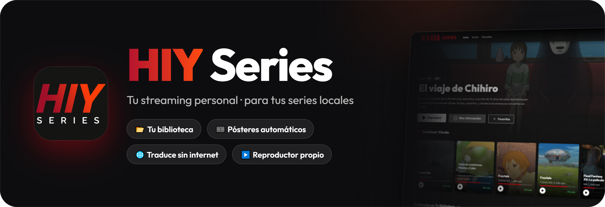
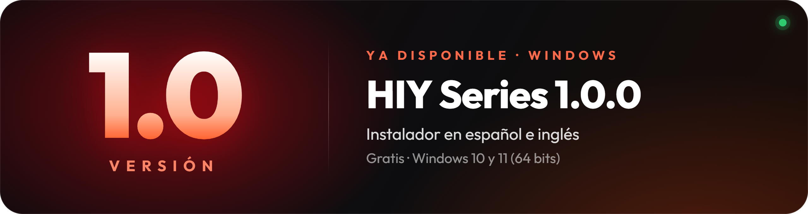
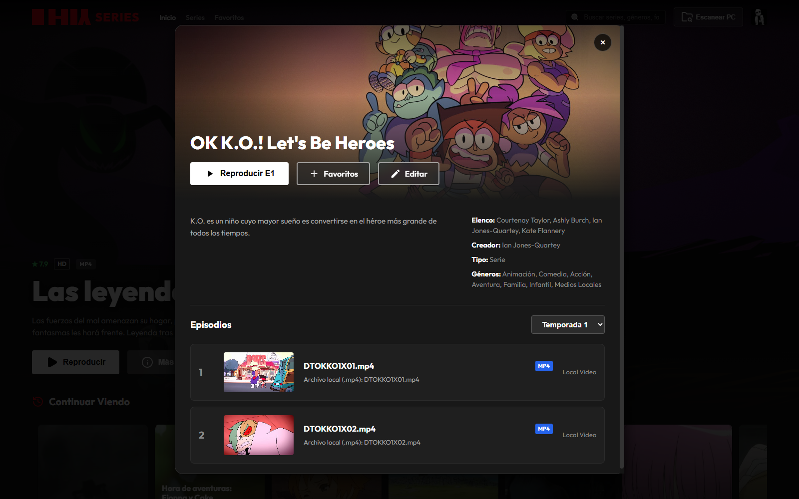
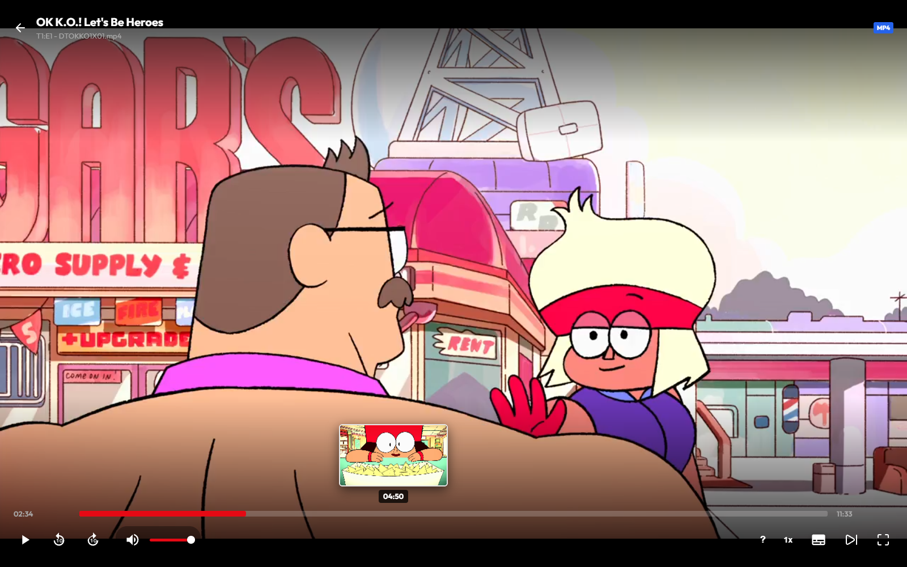

<p align="center"><a href="README.md">🇪🇸 Español</a> · <a href="README.en.md">🇬🇧 English</a></p>

<div align="center">



<br>

[](../../releases/latest)
[](../../releases/latest)
[](https://www.electronjs.org/)
[](#-en-tu-idioma)

### Tus series y películas, como en una plataforma de streaming 🍿

**Elige la carpeta con tus videos · HIY Series arma el catálogo con pósteres, descripciones y temporadas.**

<br>

<a href="../../releases/latest">
  
</a>

</div>

<div align="center">

## 🎉 Ya disponible: HIY Series 1.0.0



📂 Escanea tus carpetas · 🎞️ Pósteres y descripciones automáticos · 🌐 Traducción sin internet · 👤 Perfiles con foto · ⏯️ Continuar viendo · ❤️ Favoritos · 🎬 Reproductor con miniaturas, subtítulos y audio Dolby/DTS · 🐞 Reporta errores desde la app

</div>

<br>

## 📺 Así se ve

<div align="center">


<sub><b>Inicio</b> · banner destacado, <i>Continuar viendo</i> y filas por género</sub>

<br><br>

<table>
  <tr>
    <td align="center" width="50%"><br><sub><b>Más información</b> · temporadas y episodios</sub></td>
    <td align="center" width="50%"><br><sub><b>Reproductor</b> · miniaturas en la barra</sub></td>
  </tr>
</table>

</div>

<br>

## ✨ Lo que puede hacer

<table>
<tr>
<td width="50%" valign="top">

### 📂 Tu biblioteca
- **Escanea tus carpetas** con videos `.mp4`, `.mkv` y `.webm`
- Detecta **series, temporadas y episodios** solos
- **Busca en todo el PC** carpetas con videos
- Avisa cuando aparecen **episodios nuevos**
- **Edita** título, descripción, póster o banner a mano

</td>
<td width="50%" valign="top">

### 🎞️ Información automática
- **Descripción, géneros, año, puntuación, póster y banner** a partir del nombre de la carpeta
- Fuentes: **TMDB** (incluido), **AniList** y **TVMaze**
- **Traducción al español sin internet**, con modelos de IA locales
- Títulos de anime respetados tal cual

</td>
</tr>
<tr>
<td width="50%" valign="top">

### 🎬 Reproductor propio
- **Miniaturas** al pasar el mouse por la barra
- **Saltos rápidos**, incluso en discos mecánicos
- **Subtítulos** `.srt` / `.vtt` junto al video o cargados a mano
- Audio **Dolby / DTS** convertido al momento (con ffmpeg)
- **Siguiente episodio** automático, velocidad y atajos de teclado

</td>
<td width="50%" valign="top">

### 👤 Para toda la casa
- Hasta **5 perfiles** con foto, color e idioma
- **Continuar viendo** y **Favoritos** de cada perfil
- **Perfil de inicio** para entrar sin preguntar
- Preferencias de reproducción por perfil

</td>
</tr>
</table>

<br>

## 🌍 En tu idioma

La app y el instalador están en **español** 🇪🇸 e **inglés** 🇬🇧. El instalador te deja elegir el idioma al empezar, y la app arranca en ese mismo idioma. Puedes cambiarlo cuando quieras en **Configuración**.

<br>

## ⬇️ Instalar

1. Descarga **`HIY.Series.Setup.1.0.0.exe`** desde [Releases](../../releases/latest).
2. Elige el **idioma** y la **carpeta** de instalación.
3. Abre la app, crea tu **perfil** y pulsa **Escanear PC** para elegir la carpeta de tus series.

> [!NOTE]
> Windows SmartScreen puede avisar de que la app no es conocida, porque el instalador no está firmado. Pulsa **Más información → Ejecutar de todas formas**.

**Requisitos:** Windows 10 u 11 de 64 bits. *(Opcional)* [ffmpeg](https://ffmpeg.org/) para el audio Dolby/DTS.

<br>

## 🔒 Privacidad

- Todo funciona **en tu PC**: tus videos no se suben a ningún sitio.
- El servidor interno solo escucha en tu propio equipo (`127.0.0.1`).
- La app solo se conecta a internet para buscar **pósteres y descripciones** (TMDB, AniList, TVMaze).
- La traducción se hace **sin internet**, con modelos locales.
- Tu clave de TMDB se guarda **cifrada con Windows**.

<br>

## 🐞 ¿Encontraste un error?

<a href="../../issues/new?template=reportar-error.yml">
  
</a>

También desde la app: **menú del perfil → Reportar un error**, o **Configuración → Ayuda**.

Para que sea más fácil arreglarlo, cuenta qué pasó y cómo repetirlo, tu versión de Windows y, si es al reproducir, el formato del video. Revisa antes en [Issues](../../issues) que no esté ya reportado, y **no pegues tu clave de TMDB** ni datos personales.

<br>

## 🛠️ Para desarrolladores

<details>
<summary><b>Ejecutar desde el código</b></summary>

<br>

Necesitas [Node.js](https://nodejs.org/) 18 o superior.

```bash
git clone https://github.com/itsvnzla/hiy-series.git
cd hiy-series
npm start
```

La primera vez, `npm start` prepara todo solo (`scripts/prestart.js`): instala las dependencias, descarga los modelos de traducción (~220 MB) a `models/` y abre la app. Si no hay internet al descargar los modelos, la app abre igual (sin traducción) y se puede reintentar con `npm run models`. En Windows también puedes hacer doble clic en `start.bat`.

ffmpeg se busca en el `PATH`, en `HIY_FFMPEG_DIR`, en `%LOCALAPPDATA%\Programs\ffmpeg\bin` o en `C:\Program Files\ffmpeg\bin`.

</details>

<details>
<summary><b>Compilar el instalador</b></summary>

<br>

```bash
npm run models   # los modelos deben estar en models/ antes de compilar
npm run build
```

El instalador queda en `dist/`.

- **Asistente** en español o inglés: carpeta de instalación, accesos directos y la app empieza en el idioma elegido. Al desinstalar pregunta si borrar también la biblioteca, los perfiles y la configuración (`%APPDATA%\hiy-series`); en las actualizaciones no pregunta.
- **Clave de TMDB incluida:** antes de compilar, `npm run build` toma tu clave (la variable de entorno `TMDB_API_KEY`, o la que guardaste en Configuración) y la mete cifrada en `assets/data.bin` (ver `embedded-key.js`). Si un usuario pone la suya en Configuración, se usa la suya. Ese archivo no se sube a GitHub. Es una ofuscación: impide leer la clave a simple vista, pero alguien decidido podría sacarla del instalador.
- El instalador **no** incluye tu carpeta `data/` (biblioteca, perfiles, progreso).

</details>

<details>
<summary><b>Dónde se guardan los datos</b></summary>

<br>

- **En desarrollo** (`npm start`): en `data/` y `media/` dentro del proyecto.
- **En la app instalada**: en `%APPDATA%\hiy-series`.
- **API key de TMDB**: no va en `config.json`. Se cifra con Windows (`safeStorage` de Electron, protegido con DPAPI) en `data/sys.dat`: solo tu usuario de Windows en ese PC puede descifrarla. Si tenías la clave en `config.json` de una versión anterior, se mueve sola al abrir la app. (Con `node server.js` sin Electron se lee de `config.json` o de `TMDB_API_KEY`.)

Ninguna de estas carpetas se sube al repositorio (ver `.gitignore`).

</details>

<details>
<summary><b>Estructura del proyecto</b></summary>

<br>

```
├── main.js              # Proceso principal de Electron: ventana, menú, arranca el servidor
├── preload.js           # Puente seguro entre Electron y la interfaz
├── server.js            # API Express: series, perfiles, progreso, Mi lista, streaming, escaneo
├── metadata.js          # Metadatos (TMDB / AniList / TVMaze) y traducción local
├── embedded-key.js      # Clave de TMDB incluida (cifrada) en el instalador
├── subtitles.js         # Subtítulos externos y manuales (SRT → WebVTT)
├── audio.js             # Pistas de audio y conversión a AAC con ffmpeg
├── keyframes.js         # Fotogramas clave de MP4 y MKV/WebM
├── public/              # Interfaz (HTML, CSS, JS, fuentes, imágenes)
├── assets/              # Icono de la app
├── build/installer.nsh  # Añadidos al instalador (idioma, borrar datos al desinstalar)
├── docs/                # Imágenes del README
├── scripts/
│   ├── prestart.js         # Prepara dependencias y modelos antes de npm start
│   ├── download-models.js  # Descarga de modelos de traducción
│   └── embed-tmdb-key.js   # Incluye la clave de TMDB al compilar
├── models/              # (no versionado) Modelos ONNX de traducción
└── data/                # (no versionado) Biblioteca, perfiles, cachés y configuración
```

</details>

<details>
<summary><b>API local</b></summary>

<br>

El servidor escucha en `http://localhost:3000`.

| Método | Ruta | Descripción |
|---|---|---|
| GET | `/api/series` | Lista de series |
| GET/PUT | `/api/series/:id` | Ver / editar una serie |
| POST | `/api/scan` | Escanear una carpeta |
| POST | `/api/discover/start` | Descubrir series en el PC |
| GET | `/api/stream` | Streaming del video con soporte de rangos |
| GET/POST/PUT/DELETE | `/api/profiles…` | Gestión de perfiles |
| GET/POST/DELETE | `/api/progress` | Continuar viendo |
| GET/POST/DELETE | `/api/mylist` | Mi lista |
| GET/PUT | `/api/settings` | Ajustes (idioma, reproducción, API key de TMDB) |
| POST | `/api/metadata/refresh` | Volver a buscar metadatos |
| GET | `/api/subtitles…` | Subtítulos |
| GET | `/api/audio/info`, `/api/audio/stream` | Pistas de audio / audio convertido |
| GET | `/api/keyframes` | Fotogramas clave de un video |

</details>

<br>

## 🧰 Hecho con

<div align="center">


</div>

<br>

<div align="center">

**Licencia ISC** · Hecho por [itsvnzla](https://github.com/itsvnzla)

</div>
