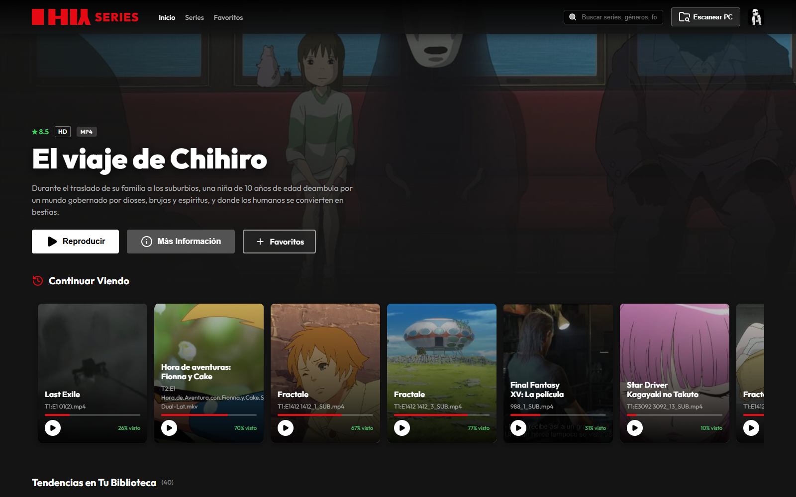

# HIY Series

Plataforma de streaming personal para tus series y películas **locales**, como app de escritorio para Windows (Electron + Express). Apuntas a una carpeta con tus videos y HIY Series arma un catálogo estilo streaming con pósteres, descripciones, perfiles y reproductor propio.



## Características

- **Biblioteca local**: escanea carpetas con videos `.mp4`, `.mkv` y `.webm` y detecta temporadas y episodios. También avisa cuando aparecen videos nuevos.
- **Metadatos automáticos**: descripción, géneros, año, puntuación, póster y banner a partir del nombre de la carpeta. Fuentes:
  1. [TMDB](https://www.themoviedb.org/) (películas, series y anime, en español; requiere API key gratuita)
  2. [AniList](https://anilist.co/) (anime, sin clave)
  3. [TVMaze](https://www.tvmaze.com/) (series, sin clave)
- **Traducción local** de descripciones inglés → español con modelos Marian (`opus-mt`) vía Transformers.js + ONNX. Funciona sin internet, sin clave y sin límites.
- **Perfiles** con foto, color, idioma y preferencias de reproducción.
- **Continuar viendo** y **Mi lista** por perfil.
- **Reproductor propio**:
  - Saltos instantáneos usando los fotogramas clave del índice MP4/MKV.
  - Subtítulos `.srt`/`.vtt` junto al video o cargados a mano (los `.srt` se convierten a WebVTT).
  - Audio AC3, E-AC3, DTS y TrueHD convertido a AAC en tiempo real con ffmpeg.
  - Reproducción automática del siguiente episodio, velocidad y volumen.
- **Interfaz en español e inglés**, con pantalla de bienvenida y tutorial.

## Requisitos

- [Node.js](https://nodejs.org/) 18 o superior
- Windows (la compilación del instalador está configurada para Windows/NSIS)
- *(Opcional)* [ffmpeg](https://ffmpeg.org/) para el audio Dolby/DTS. Se busca en el `PATH`, en `HIY_FFMPEG_DIR`, en `%LOCALAPPDATA%\Programs\ffmpeg\bin` o en `C:\Program Files\ffmpeg\bin`.
- *(Opcional)* Una API key gratuita de TMDB para mejores metadatos.

## Instalación y uso

```bash
git clone https://github.com/itsvnzla/hiy-series.git
cd hiy-series
npm start
```

Eso es todo. La primera vez, `npm start` prepara todo solo (`scripts/prestart.js`):

1. Instala las dependencias (`npm install`) si faltan.
2. Descarga los modelos de traducción (~220 MB, desde Hugging Face) a `models/`.
3. Abre la app.

Las siguientes veces arranca directamente. Si no hay internet al descargar los modelos, la app abre igual (sin traducción); se puede reintentar con `npm run models`.

En Windows también puedes hacer doble clic en `start.bat`.

1. Elige la carpeta donde están tus series (menú o botón de escanear).
2. HIY Series detecta las series y busca sus metadatos automáticamente.
3. *(Opcional)* En **Ajustes**, pega tu API key de TMDB. También puedes definir la variable de entorno `TMDB_API_KEY`.

## Compilar el instalador

```bash
npm run models   # los modelos deben estar en models/ antes de compilar
npm run build
```

El instalador queda en `dist/`.

> ⚠️ El instalador incluye la carpeta `data/` tal como esté en ese momento (ver `build.files` en `package.json`). Si ahí está tu `config.json` con la API key de TMDB o tu biblioteca personal, se incluirán en el instalador. Vacía o quita `data/` antes de compilar si vas a compartirlo.

## Estructura del proyecto

```
├── main.js              # Proceso principal de Electron: ventana, menú, arranca el servidor
├── preload.js           # Puente seguro entre Electron y la interfaz (selector de carpetas)
├── server.js            # API Express: series, perfiles, progreso, Mi lista, streaming, escaneo
├── metadata.js          # Búsqueda de metadatos (TMDB / AniList / TVMaze) y traducción local
├── subtitles.js         # Subtítulos externos y manuales (SRT → WebVTT)
├── audio.js             # Detección de pistas de audio y conversión a AAC con ffmpeg
├── keyframes.js         # Lectura de fotogramas clave de MP4 y MKV/WebM
├── public/              # Interfaz (HTML, CSS, JS, fuentes, imágenes)
├── assets/              # Icono de la app
├── scripts/
│   ├── prestart.js         # Prepara dependencias y modelos antes de npm start
│   └── download-models.js  # Descarga de modelos de traducción
├── models/              # (no versionado) Modelos ONNX de traducción
└── data/                # (no versionado) Biblioteca, perfiles, cachés y configuración
```

## Datos del usuario

- **En desarrollo** (`npm start`): los datos se guardan en `data/` y `media/` dentro del proyecto.
- **En la app instalada**: se guardan en `%APPDATA%\HIY Series`.

Ninguna de estas carpetas se sube al repositorio (ver `.gitignore`).

## API local

El servidor escucha en `http://localhost:3000`. Rutas principales:

| Método | Ruta | Descripción |
|---|---|---|
| GET | `/api/series` | Lista de series |
| GET/PUT | `/api/series/:id` | Ver / editar una serie |
| POST | `/api/scan` | Escanear una carpeta |
| POST | `/api/discover/start` | Descubrir series en una carpeta |
| GET | `/api/stream` | Streaming del video con soporte de rangos |
| GET/POST/PUT/DELETE | `/api/profiles…` | Gestión de perfiles |
| GET/POST/DELETE | `/api/progress` | Continuar viendo |
| GET/POST/DELETE | `/api/mylist` | Mi lista |
| GET/PUT | `/api/settings` | Ajustes (idioma, reproducción, API key de TMDB) |
| POST | `/api/metadata/refresh` | Volver a buscar metadatos |
| GET | `/api/subtitles…` | Subtítulos |
| GET | `/api/audio/info`, `/api/audio/stream` | Pistas de audio / audio convertido |
| GET | `/api/keyframes` | Fotogramas clave de un video |

## Tecnologías

Electron · Node.js · Express · Transformers.js (ONNX Runtime) · HTML/CSS/JS sin frameworks · Lucide icons

## Licencia

ISC
